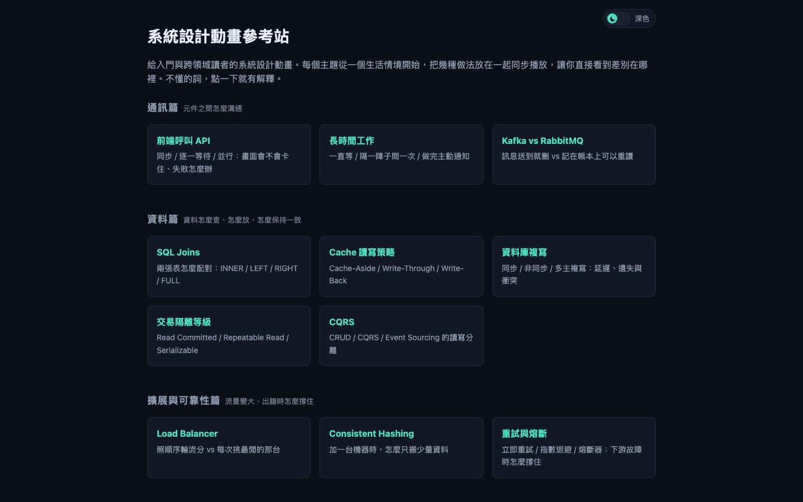

<!-- 本檔由 /sync-docs 自動生成，請勿手動編輯——手改內容下次會被覆蓋。 -->
# Html-ArchitectVault

給入門與跨領域讀者的系統設計互動動畫教學站。



線上網站：https://lingaoscar.github.io/Html-ArchitectVault/

## 技術棧
純靜態網站：HTML + CSS + 原生 ES modules，無建置工具、無外部函式庫或 CDN。以 GitHub Pages 發佈。

## 快速開始
```bash
python3 -m http.server 8765
# 開啟 http://localhost:8765/
```
完整開發說明見 [docs/dev.md](docs/dev.md)。

## 目錄結構
| 路徑 | 用途 |
|---|---|
| `index.html` | 站台首頁（主題列表） |
| `topics/` | 24 個教學主題，每個含 `index.html`、`steps.js`、`render.js`、`style.css` |
| `assets/js/engine/` | 播放器與共用引擎（player、diagram、timeline 等） |
| `assets/css/` | 共用樣式與 design tokens |
| `assets/js/` | `glossary.js` 術語表、`theme.js` 深淺色切換 |
| `design-system/` | Clarity 設計系統變體 |
| `docs/` | 開發文件與截圖 |
